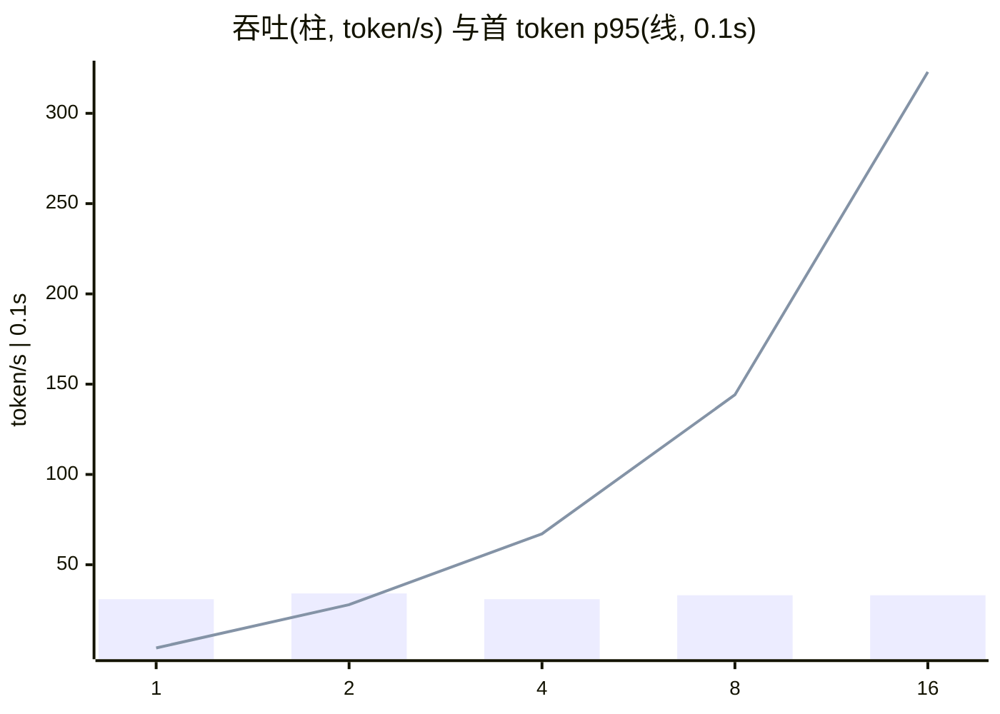

# 性能基准报告：OpenAI 兼容网关 + Ollama

## 环境

- 机器：Windows-11-10.0.26100-SP0，8 逻辑核，无 GPU（CPU 推理）
- 后端：Ollama 0.40.12，模型 `qwen2.5:0.5b`，`OLLAMA_NUM_PARALLEL`=`默认`
- 请求：流式 `/v1/chat/completions`，`max_tokens=64`，`temperature=0`，提示词要求长回答
- 压测机与模型在同一台机器上，Locust 自身也占 CPU，绝对数值只代表本机
- 生成时间：2026-10-30 17:03

## 1. 冷启动 vs 热启动（单请求）

| | 样本数 | 首 token p50 | 首 token 最大 | 端到端 p50 |
|---|---|---|---|---|
| 冷启动（先卸载模型） | 3 | 1.84s | 1.90s | 3.88s |
| 热启动 | 6 | 0.32s | 0.33s | 1.96s |

冷启动首 token 约是热启动的 **6 倍**，多出的时间是把模型权重加载进内存。热启动单路生成速度约 **40 token/s**。

## 2. 阶梯并发（闭环，每档固定时长）

| 并发 | 成功请求 | RPS | 吞吐 token/s | TPM | 首 token p50 | 首 token p95 | 端到端 p95 | 错误率 |
|---|---|---|---|---|---|---|---|---|
| 1 | 29 | 0.48 | 30.9 | 1856 | 0.33s | 0.39s | 2.17s | 0.0% |
| 2 | 32 | 0.53 | 34.1 | 2048 | 1.76s | 2.79s | 5.23s | 0.0% |
| 4 | 29 | 0.48 | 30.9 | 1856 | 5.71s | 6.71s | 8.90s | 0.0% |
| 8 | 31 | 0.52 | 33.1 | 1984 | 12.91s | 14.41s | 16.22s | 0.0% |
| 16 | 31 | 0.52 | 33.1 | 1984 | 25.82s | 32.29s | 33.97s | 0.0% |

用 Little 定律校验（并发数 = 吞吐 × 时延，所以时延 ≈ 并发数 / RPS）：

| 并发 | 预测时延 N/RPS | 实测端到端 p50 |
|---|---|---|
| 1 | 2.07s | 1.93s |
| 2 | 3.75s | 3.51s |
| 4 | 8.28s | 7.82s |
| 8 | 15.48s | 15.06s |
| 16 | 30.97s | 27.93s |

两者吻合说明请求都在系统里排队，没有被丢弃或卡死；吞吐已经到顶，时延只随并发线性增长。

**饱和点约在 2 并发**：再加到 4 并发，吞吐只从 34.1 变到 30.9 token/s，首 token p95 却从 2.79s 涨到 6.71s。超过这个点，多出来的请求只是在后端排队。

## 3. 负载下限流

API Key 配额 `rpm=12`（令牌桶容量 12，每秒回填 0.20），8 并发压 30 秒，`max_tokens=8`，客户端遵守 `Retry-After` 退避。

| 指标 | 值 |
|---|---|
| 总请求 | 65 |
| 放行（200） | 17 |
| 理论最多放行 | 18（容量 + 回填速度 × 时长） |
| 被限流（429） | 48（73.8%） |
| 429 响应 p95 | 7.9ms |
| 其他错误 | 0 |

放行数 不超过理论上限，被拒请求在网关直接返回，不占用模型算力。

## 4. 负载下超时

网关超时调到 `1.5s`（只约束首个 chunk），16 并发压 30 秒，客户端出错后退避 1 秒。

| 结果 | 次数 |
|---|---|
| circuit_open | 239 |
| upstream_timeout | 17 |
| 200 | 13 |

504 请求的端到端 p50 3.04s、最大 3.06s。`qwen-mini` 配了降级模型，主模型超时后会再试降级模型，所以客户端最坏要等 **超时 × 降级链长度 = 1.5 × 2 = 3.0s**，而不是配置里的 1.5s。设置超时要按整条链算。

压测停止 11 秒后（熔断半开窗口已过）单请求：状态 200，首 token 0.37s，端到端 1.71s（与热启动对比即可判断后端是否已恢复）。

出现了 `circuit_open`：连续超时触发了熔断，网关直接拒绝后续请求，等于自动卸掉了一部分负载。

## 原始数据

`reports/raw/` 下每个场景有 Locust 的 CSV 和逐请求 JSONL。
